# Minimap & POI iconography

[All tables](README.md) · [Map generation](map-generation.md)

All 142 Point of Interest icons, quest markers, hero map pins, chapter maps, and minimap UI overlays under [`images/ui/minimap/`](../images/ui/minimap/).

## Points of Interest

| Icon | Name | Variant | Tier | Size | File |
|---|---|---|---|---|---|
| 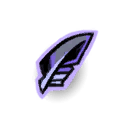 | Altar of Heroes | base | high | 128×128 | [`icons/high/Minimap_IconHigh_Altar.png`](../images/ui/minimap/icons/high/Minimap_IconHigh_Altar.png) |
| 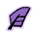 | Altar of Heroes | base | standard | 48×48 | [`icons/Map_Icons_Altar.png`](../images/ui/minimap/icons/Map_Icons_Altar.png) |
| 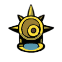 | Astral Shrine | base | high | 128×128 | [`icons/high/Map_IconHigh_Astrolab.png`](../images/ui/minimap/icons/high/Map_IconHigh_Astrolab.png) |
|  | Astral Shrine | outline | high | 128×128 | [`icons/high/Map_IconHigh_Astrolab_Outline.png`](../images/ui/minimap/icons/high/Map_IconHigh_Astrolab_Outline.png) |
|  | Astral Shrine | base | standard | 48×48 | [`icons/Map_Icons_Astrolab.png`](../images/ui/minimap/icons/Map_Icons_Astrolab.png) |
|  | Astral Shrine | outline | standard | 48×48 | [`icons/Map_Icons_Astrolab_Outline.png`](../images/ui/minimap/icons/Map_Icons_Astrolab_Outline.png) |
| 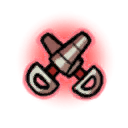 | Blood Ritual | base | high | 128×128 | [`icons/high/Map_IconHigh_KeyKeeper.png`](../images/ui/minimap/icons/high/Map_IconHigh_KeyKeeper.png) |
| 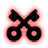 | Blood Ritual | base | standard | 48×48 | [`icons/Map_Icons_KeyKeeper.png`](../images/ui/minimap/icons/Map_Icons_KeyKeeper.png) |
| 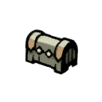 | Chest | base | high | 128×128 | [`icons/high/Minimap_IconHigh_Chest.png`](../images/ui/minimap/icons/high/Minimap_IconHigh_Chest.png) |
|  | Chest | outline | high | 128×128 | [`icons/high/Minimap_IconHigh_Chest_Outline.png`](../images/ui/minimap/icons/high/Minimap_IconHigh_Chest_Outline.png) |
| 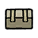 | Chest | base | standard | 48×48 | [`icons/Map_Icons_Common_Chest.png`](../images/ui/minimap/icons/Map_Icons_Common_Chest.png) |
|  | Chest | outline | standard | 48×48 | [`icons/Map_Icons_Common_Chest_Outline.png`](../images/ui/minimap/icons/Map_Icons_Common_Chest_Outline.png) |
| 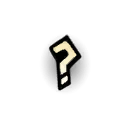 | Corpse | base | high | 128×128 | [`icons/high/Minimap_IconHigh_Corpse.png`](../images/ui/minimap/icons/high/Minimap_IconHigh_Corpse.png) |
|  | Corpse | base | standard | 48×48 | [`icons/Map_Icons_Corpse.png`](../images/ui/minimap/icons/Map_Icons_Corpse.png) |
|  | Corpse | base | standard | 48×48 | [`icons/Refugee.png`](../images/ui/minimap/icons/Refugee.png) |
| 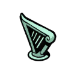 | Dagda's Harp | base | high | 128×128 | [`icons/high/Map_Harp_IconHigh.png`](../images/ui/minimap/icons/high/Map_Harp_IconHigh.png) |
|  | Dagda's Harp | outline | high | 128×128 | [`icons/high/Map_Harp_IconHigh_Outline.png`](../images/ui/minimap/icons/high/Map_Harp_IconHigh_Outline.png) |
| 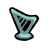 | Dagda's Harp | base | standard | 48×48 | [`icons/Map_Harp_Icon.png`](../images/ui/minimap/icons/Map_Harp_Icon.png) |
|  | Dagda's Harp | outline | standard | 48×48 | [`icons/Map_Harp_Icon_Outline.png`](../images/ui/minimap/icons/Map_Harp_Icon_Outline.png) |
| 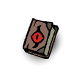 | Grimoire | base | high | 128×128 | [`icons/high/Minimap_IconHigh_Book.png`](../images/ui/minimap/icons/high/Minimap_IconHigh_Book.png) |
|  | Grimoire | open | high | 128×128 | [`icons/high/Minimap_IconHigh_Book_Open.png`](../images/ui/minimap/icons/high/Minimap_IconHigh_Book_Open.png) |
|  | Grimoire | outline | high | 128×128 | [`icons/high/Minimap_IconHigh_Book_Outline.png`](../images/ui/minimap/icons/high/Minimap_IconHigh_Book_Outline.png) |
| 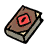 | Grimoire | base | standard | 48×48 | [`icons/secret-book.png`](../images/ui/minimap/icons/secret-book.png) |
|  | Grimoire | outline | standard | 48×48 | [`icons/secret-book_Outline.png`](../images/ui/minimap/icons/secret-book_Outline.png) |
|  | Grimoire | open | standard | 48×48 | [`icons/secret-book_open.png`](../images/ui/minimap/icons/secret-book_open.png) |
| 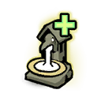 | Healing Fountain | base | high | 128×128 | [`icons/high/Minimap_IconHigh_Fountain.png`](../images/ui/minimap/icons/high/Minimap_IconHigh_Fountain.png) |
|  | Healing Fountain | alt | high | 128×128 | [`icons/high/Minimap_IconHigh_Fountain2.png`](../images/ui/minimap/icons/high/Minimap_IconHigh_Fountain2.png) |
|  | Healing Fountain | base | standard | 48×48 | [`icons/Map_Icons_Common_Fountain.png`](../images/ui/minimap/icons/Map_Icons_Common_Fountain.png) |
| 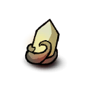 | Large Dream Crystal | base | high | 128×128 | [`icons/high/Minimap_IconHigh_Crystal.png`](../images/ui/minimap/icons/high/Minimap_IconHigh_Crystal.png) |
|  | Large Dream Crystal | outline | high | 128×128 | [`icons/high/Minimap_IconHigh_Crystal_Outline.png`](../images/ui/minimap/icons/high/Minimap_IconHigh_Crystal_Outline.png) |
|  | Large Dream Crystal | base | standard | 48×48 | [`icons/Map_Icons_Crystal.png`](../images/ui/minimap/icons/Map_Icons_Crystal.png) |
|  | Large Dream Crystal | outline | standard | 48×48 | [`icons/Map_Icons_Crystal_Outline.png`](../images/ui/minimap/icons/Map_Icons_Crystal_Outline.png) |
| 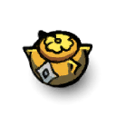 | Leprechaun's Cauldron | base | high | 128×128 | [`icons/high/Minimap_IconHigh_Cauldron.png`](../images/ui/minimap/icons/high/Minimap_IconHigh_Cauldron.png) |
|  | Leprechaun's Cauldron | outline | high | 128×128 | [`icons/high/Minimap_IconHigh_Cauldron_Outline.png`](../images/ui/minimap/icons/high/Minimap_IconHigh_Cauldron_Outline.png) |
|  | Leprechaun's Cauldron | base | standard | 48×48 | [`icons/Map_Icon_Cauldron.png`](../images/ui/minimap/icons/Map_Icon_Cauldron.png) |
|  | Leprechaun's Cauldron | outline | standard | 48×48 | [`icons/Map_Icon_Cauldron_Outline.png`](../images/ui/minimap/icons/Map_Icon_Cauldron_Outline.png) |
| 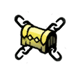 | Locked Chest | base | high | 128×128 | [`icons/high/Minimap_IconHigh_Locked_Chest.png`](../images/ui/minimap/icons/high/Minimap_IconHigh_Locked_Chest.png) |
|  | Locked Chest | outline | high | 128×128 | [`icons/high/Minimap_IconHigh_Locked_Chest_Outline.png`](../images/ui/minimap/icons/high/Minimap_IconHigh_Locked_Chest_Outline.png) |
|  | Locked Chest | base | standard | 48×48 | [`icons/Map_Icons_Common_Locked_Chest.png`](../images/ui/minimap/icons/Map_Icons_Common_Locked_Chest.png) |
|  | Locked Chest | outline | standard | 48×48 | [`icons/Map_Icons_Common_Locked_Chest_Outline.png`](../images/ui/minimap/icons/Map_Icons_Common_Locked_Chest_Outline.png) |
| 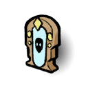 | Magic Mirror | base | high | 128×128 | [`icons/high/Map_Mirror_IconHigh.png`](../images/ui/minimap/icons/high/Map_Mirror_IconHigh.png) |
|  | Magic Mirror | outline | high | 128×128 | [`icons/high/Map_Mirror_IconHigh_Oultline.png`](../images/ui/minimap/icons/high/Map_Mirror_IconHigh_Oultline.png) |
|  | Magic Mirror | base | standard | 49×49 | [`icons/Map_Mirror_Icon.png`](../images/ui/minimap/icons/Map_Mirror_Icon.png) |
|  | Magic Mirror | outline | standard | 49×49 | [`icons/Map_Mirror_Icon_Outline.png`](../images/ui/minimap/icons/Map_Mirror_Icon_Outline.png) |
|  | Magical Object | base | high | 128×128 | [`icons/high/Minimap_IconHigh_Object.png`](../images/ui/minimap/icons/high/Minimap_IconHigh_Object.png) |
|  | Magical Object | base | standard | 48×48 | [`icons/Map_Icons_Object.png`](../images/ui/minimap/icons/Map_Icons_Object.png) |
|  | Master Nightmare | base | high | 128×128 | [`icons/high/Minimap_IconHigh_Boss.png`](../images/ui/minimap/icons/high/Minimap_IconHigh_Boss.png) |
| 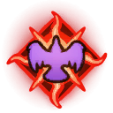 | Master Nightmare | awaken | high | 128×128 | [`icons/high/Minimap_IconHigh_Boss_Awaken.png`](../images/ui/minimap/icons/high/Minimap_IconHigh_Boss_Awaken.png) |
| 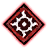 | Master Nightmare | base | standard | 48×48 | [`icons/Map_Icons_FinalBoss.png`](../images/ui/minimap/icons/Map_Icons_FinalBoss.png) |
|  | Master Nightmare | awaken | standard | 48×48 | [`icons/Map_Icons_FinalBoss_Awaken.png`](../images/ui/minimap/icons/Map_Icons_FinalBoss_Awaken.png) |
|  | Nightmare Key | base | high | 128×128 | [`icons/high/Map_IconHigh_Key.png`](../images/ui/minimap/icons/high/Map_IconHigh_Key.png) |
|  | Nightmare Key | base | standard | 48×48 | [`icons/Map_Icon_Key.png`](../images/ui/minimap/icons/Map_Icon_Key.png) |
| 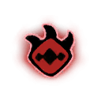 | Nightmare Tumor | base | high | 128×128 | [`icons/high/Minimap_IconHigh_Tumor.png`](../images/ui/minimap/icons/high/Minimap_IconHigh_Tumor.png) |
| 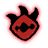 | Nightmare Tumor | base | standard | 48×48 | [`icons/Map_Icons_Tumor.png`](../images/ui/minimap/icons/Map_Icons_Tumor.png) |
| 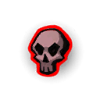 | Optional Boss | base | high | 128×128 | [`icons/high/Map_Icons_Boss.png`](../images/ui/minimap/icons/high/Map_Icons_Boss.png) |
| 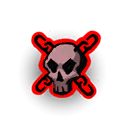 | Optional Boss | locked | high | 128×128 | [`icons/high/Map_Icons_Boss_Locked.png`](../images/ui/minimap/icons/high/Map_Icons_Boss_Locked.png) |
|  | Optional Boss | base | high | 128×128 | [`icons/high/Minimap_IconHigh_BossMini.png`](../images/ui/minimap/icons/high/Minimap_IconHigh_BossMini.png) |
|  | Optional Boss | base | standard | 48×48 | [`icons/Map_Icons_Boss_Den.png`](../images/ui/minimap/icons/Map_Icons_Boss_Den.png) |
| 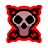 | Optional Boss | locked | standard | 48×48 | [`icons/Map_Icons_Boss_Den_Locked.png`](../images/ui/minimap/icons/Map_Icons_Boss_Den_Locked.png) |
| 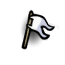 | Refugees’ Camp | base | high | 128×128 | [`icons/high/Minimap_IconHigh_Refugees.png`](../images/ui/minimap/icons/high/Minimap_IconHigh_Refugees.png) |
| 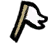 | Refugees’ Camp | base | standard | 48×48 | [`icons/Map_Icons_Refugees.png`](../images/ui/minimap/icons/Map_Icons_Refugees.png) |
| 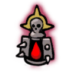 | Sacrificial Idol | base | high | 128×128 | [`icons/high/Minimap_IconHigh_BloodFountain.png`](../images/ui/minimap/icons/high/Minimap_IconHigh_BloodFountain.png) |
| 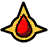 | Sacrificial Idol | base | standard | 48×48 | [`icons/Map_Icons_BloodFountain.png`](../images/ui/minimap/icons/Map_Icons_BloodFountain.png) |
| 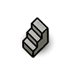 | Stairs | left | high | 128×128 | [`icons/high/Minimap_IconHigh_Stairs_Left.png`](../images/ui/minimap/icons/high/Minimap_IconHigh_Stairs_Left.png) |
| 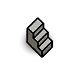 | Stairs | right | high | 128×128 | [`icons/high/Minimap_IconHigh_Stairs_Right.png`](../images/ui/minimap/icons/high/Minimap_IconHigh_Stairs_Right.png) |
|  | Stairs | left | standard | 48×48 | [`icons/Map_Icon_Avalon_Stairs_Left.png`](../images/ui/minimap/icons/Map_Icon_Avalon_Stairs_Left.png) |
|  | Stairs | right | standard | 48×48 | [`icons/Map_Icon_Avalon_Stairs_Right.png`](../images/ui/minimap/icons/Map_Icon_Avalon_Stairs_Right.png) |
| 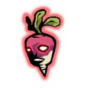 | Stingy Jack | base | high | 128×128 | [`icons/high/Map_StingyJack_IconHigh.png`](../images/ui/minimap/icons/high/Map_StingyJack_IconHigh.png) |
|  | Stingy Jack | base | standard | 48×48 | [`icons/Map_StingyJack_Icon.png`](../images/ui/minimap/icons/Map_StingyJack_Icon.png) |
| 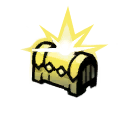 | Super Chest | base | high | 128×128 | [`icons/high/Minimap_IconHigh_Chest_Super.png`](../images/ui/minimap/icons/high/Minimap_IconHigh_Chest_Super.png) |
|  | Super Chest | outline | high | 128×128 | [`icons/high/Minimap_IconHigh_Chest_Super_Outline.png`](../images/ui/minimap/icons/high/Minimap_IconHigh_Chest_Super_Outline.png) |
|  | Super Chest | base | standard | 48×48 | [`icons/Map_Icons_Chest_Super.png`](../images/ui/minimap/icons/Map_Icons_Chest_Super.png) |
|  | Super Chest | outline | standard | 48×48 | [`icons/Map_Icons_Chest_Super_Outline.png`](../images/ui/minimap/icons/Map_Icons_Chest_Super_Outline.png) |
|  | Teleporter | base | high | 128×128 | [`icons/high/Minimap_IconHigh_TP.png`](../images/ui/minimap/icons/high/Minimap_IconHigh_TP.png) |
| 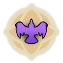 | The Sandman, Dream Dealer | base | high | 128×128 | [`icons/high/Minimap_IconHigh_SandmanTP.png`](../images/ui/minimap/icons/high/Minimap_IconHigh_SandmanTP.png) |
| 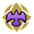 | The Sandman, Dream Dealer | base | standard | 48×48 | [`icons/Map_Icons_Sandman.png`](../images/ui/minimap/icons/Map_Icons_Sandman.png) |
| 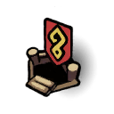 | Thieves' Stash | base | high | 128×128 | [`icons/high/Map_Thieves_Stash_IconHigh.png`](../images/ui/minimap/icons/high/Map_Thieves_Stash_IconHigh.png) |
|  | Thieves' Stash | outline | high | 128×128 | [`icons/high/Map_Thieves_Stash_IconHigh_Outline.png`](../images/ui/minimap/icons/high/Map_Thieves_Stash_IconHigh_Outline.png) |
|  | Thieves' Stash | base | standard | 48×48 | [`icons/Map_Thieves_Stash_Icon.png`](../images/ui/minimap/icons/Map_Thieves_Stash_Icon.png) |
|  | Thieves' Stash | outline | standard | 48×48 | [`icons/Map_Thieves_Stash_Icon_Outline.png`](../images/ui/minimap/icons/Map_Thieves_Stash_Icon_Outline.png) |
| 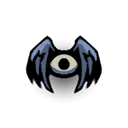 | Vision Tower | base | high | 128×128 | [`icons/high/Minimap_IconHigh_BabaEye.png`](../images/ui/minimap/icons/high/Minimap_IconHigh_BabaEye.png) |
|  | Vision Tower | outline | high | 128×128 | [`icons/high/Minimap_IconHigh_BabaEye_Outline.png`](../images/ui/minimap/icons/high/Minimap_IconHigh_BabaEye_Outline.png) |
|  | Vision Tower | base | standard | 40×40 | [`icons/Map_Icons_Baba_Yaga_Eye.png`](../images/ui/minimap/icons/Map_Icons_Baba_Yaga_Eye.png) |
|  | Vision Tower | outline | standard | 40×40 | [`icons/Map_Icons_Baba_Yaga_Eye_Outline.png`](../images/ui/minimap/icons/Map_Icons_Baba_Yaga_Eye_Outline.png) |
| 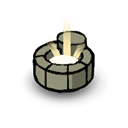 | Wishing Well | base | high | 128×128 | [`icons/high/Minimap_IconHigh_Well.png`](../images/ui/minimap/icons/high/Minimap_IconHigh_Well.png) |
|  | Wishing Well | outline | high | 128×128 | [`icons/high/Minimap_IconHigh_Well_Outline.png`](../images/ui/minimap/icons/high/Minimap_IconHigh_Well_Outline.png) |
|  | Wishing Well | outline | standard | 48×48 | [`icons/Map_Icon_Wishing_Wel_Outline.png`](../images/ui/minimap/icons/Map_Icon_Wishing_Wel_Outline.png) |
| 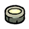 | Wishing Well | base | standard | 48×48 | [`icons/Map_Icon_Wishing_Well.png`](../images/ui/minimap/icons/Map_Icon_Wishing_Well.png) |

## Quests & Map Objectives

| Icon | Name | Variant | Tier | Size | File |
|---|---|---|---|---|---|
| 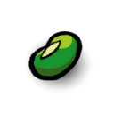 | Magic Bean | base | high | 128×128 | [`icons/high/Minimap_Icons_High_Bean.png`](../images/ui/minimap/icons/high/Minimap_Icons_High_Bean.png) |
| 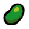 | Magic Bean | base | standard | 48×48 | [`icons/Map_Icons_Bean.png`](../images/ui/minimap/icons/Map_Icons_Bean.png) |
| 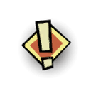 | Side Quest | base | high | 128×128 | [`icons/high/Minimap_IconHigh_Mission.png`](../images/ui/minimap/icons/high/Minimap_IconHigh_Mission.png) |
| 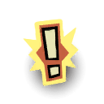 | Side Quest | open | high | 128×128 | [`icons/high/Minimap_IconHigh_Mission_Open.png`](../images/ui/minimap/icons/high/Minimap_IconHigh_Mission_Open.png) |
|  | Side Quest | base | standard | 44×44 | [`icons/Map_Icons_Npc_Quest.png`](../images/ui/minimap/icons/Map_Icons_Npc_Quest.png) |
|  | Side Quest | open | standard | 48×48 | [`icons/Map_Icons_Npc_Quest_Open.png`](../images/ui/minimap/icons/Map_Icons_Npc_Quest_Open.png) |
| 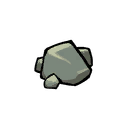 | Stone reserve | base | high | 128×128 | [`icons/high/Minimap_IconHigh_3Pigs_Resources_Stone.png`](../images/ui/minimap/icons/high/Minimap_IconHigh_3Pigs_Resources_Stone.png) |
| 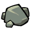 | Stone reserve | base | standard | 64×64 | [`icons/Map_Icons_3Pigs_Resources_Stone.png`](../images/ui/minimap/icons/Map_Icons_3Pigs_Resources_Stone.png) |
| 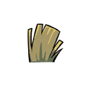 | Straw reserve | base | high | 128×128 | [`icons/high/Minimap_IconHigh_3Pigs_ResourcesStraw.png`](../images/ui/minimap/icons/high/Minimap_IconHigh_3Pigs_ResourcesStraw.png) |
|  | Straw reserve | base | standard | 64×64 | [`icons/Map_Icons_3Pigs_Resources_Straw.png`](../images/ui/minimap/icons/Map_Icons_3Pigs_Resources_Straw.png) |
| 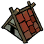 | Three Little Pigs — Stone House | base | standard | 64×64 | [`icons/Map_Icons_3Pigs_House_Stone.png`](../images/ui/minimap/icons/Map_Icons_3Pigs_House_Stone.png) |
| 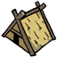 | Three Little Pigs — Straw House | base | standard | 64×64 | [`icons/Map_Icons_3Pigs_House_Straw.png`](../images/ui/minimap/icons/Map_Icons_3Pigs_House_Straw.png) |
| 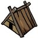 | Three Little Pigs — Wood House | base | standard | 64×64 | [`icons/Map_Icons_3Pigs_House_Wood.png`](../images/ui/minimap/icons/Map_Icons_3Pigs_House_Wood.png) |
| 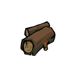 | Wood reserve | base | high | 128×128 | [`icons/high/Minimap_IconHigh_3Pigs_ResourcesWood.png`](../images/ui/minimap/icons/high/Minimap_IconHigh_3Pigs_ResourcesWood.png) |
| 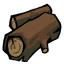 | Wood reserve | base | standard | 64×64 | [`icons/Map_Icons_3Pigs_Resources_Wood.png`](../images/ui/minimap/icons/Map_Icons_3Pigs_Resources_Wood.png) |

## Hero & Player Map Pins

| Icon | Name | Variant | Tier | Size | File |
|---|---|---|---|---|---|
|  | Aladdin (Map Pin) | base | high | 128×128 | [`icons/high/Minimap_IconHigh_Aladdin.png`](../images/ui/minimap/icons/high/Minimap_IconHigh_Aladdin.png) |
|  | Beowulf (Map Pin) | base | high | 128×128 | [`icons/high/Minimap_IconHigh_Beowulf.png`](../images/ui/minimap/icons/high/Minimap_IconHigh_Beowulf.png) |
|  | Carmilla (Map Pin) | base | high | 128×128 | [`icons/high/Minimap_IconHigh_Carmilla.png`](../images/ui/minimap/icons/high/Minimap_IconHigh_Carmilla.png) |
|  | Crow Mark | base | standard | 48×48 | [`icons/Map_Icons_Crow_Mark.png`](../images/ui/minimap/icons/Map_Icons_Crow_Mark.png) |
|  | Geppetto (Map Pin) | base | high | 128×128 | [`icons/high/Minimap_IconHigh_Geppetto.png`](../images/ui/minimap/icons/high/Minimap_IconHigh_Geppetto.png) |
|  | Juliet (Map Pin) | base | high | 128×128 | [`icons/high/Minimap_IconHigh_Juliet.png`](../images/ui/minimap/icons/high/Minimap_IconHigh_Juliet.png) |
|  | Kintarō (Map Pin) | base | high | 128×128 | [`icons/high/Minimap_IconHigh_Kintaro.png`](../images/ui/minimap/icons/high/Minimap_IconHigh_Kintaro.png) |
|  | Melusine (Map Pin) | base | high | 128×128 | [`icons/high/Minimap_IconHigh_Mermaid.png`](../images/ui/minimap/icons/high/Minimap_IconHigh_Mermaid.png) |
|  | Merlin (Map Pin) | base | high | 128×128 | [`icons/high/Minimap_IconHigh_Merlin.png`](../images/ui/minimap/icons/high/Minimap_IconHigh_Merlin.png) |
|  | Other Player Pin | base | standard | 114×114 | [`icons/Map_Icons_OtherPlayer_Pin.png`](../images/ui/minimap/icons/Map_Icons_OtherPlayer_Pin.png) |
|  | Other Player Pin | outline | standard | 114×114 | [`icons/Map_Icons_OtherPlayer_Pin_Outline.png`](../images/ui/minimap/icons/Map_Icons_OtherPlayer_Pin_Outline.png) |
|  | Player Pin | base | high | 128×128 | [`icons/high/Minimap_IconHigh_Player.png`](../images/ui/minimap/icons/high/Minimap_IconHigh_Player.png) |
|  | Player Pin | base | standard | 88×88 | [`icons/Map_Icons_Player_Pin.png`](../images/ui/minimap/icons/Map_Icons_Player_Pin.png) |
|  | Player Pin | halo | standard | 88×88 | [`icons/Map_Icons_Player_Pin_Halo.png`](../images/ui/minimap/icons/Map_Icons_Player_Pin_Halo.png) |
|  | Player Pin | outline | standard | 114×114 | [`icons/Map_Icons_Player_Pin_Outline.png`](../images/ui/minimap/icons/Map_Icons_Player_Pin_Outline.png) |
|  | Romeo (Map Pin) | base | high | 128×128 | [`icons/high/Minimap_IconHigh_Romeo.png`](../images/ui/minimap/icons/high/Minimap_IconHigh_Romeo.png) |
|  | Scarlet (Map Pin) | base | high | 128×128 | [`icons/high/Minimap_IconHigh_Scarlet.png`](../images/ui/minimap/icons/high/Minimap_IconHigh_Scarlet.png) |
|  | Sun Wukong (Map Pin) | base | high | 128×128 | [`icons/high/Minimap_IconHigh_SunWukong.png`](../images/ui/minimap/icons/high/Minimap_IconHigh_SunWukong.png) |
|  | Sun Wukong Reveal | base | standard | 128×128 | [`icons/Map_Sun_Wukong_Reveal.png`](../images/ui/minimap/icons/Map_Sun_Wukong_Reveal.png) |
|  | The Pied Piper (Map Pin) | base | high | 128×128 | [`icons/high/Minimap_IconHigh_Piper.png`](../images/ui/minimap/icons/high/Minimap_IconHigh_Piper.png) |
|  | The Snow Queen (Map Pin) | base | high | 128×128 | [`icons/high/Minimap_IconHigh_SnowQueen.png`](../images/ui/minimap/icons/high/Minimap_IconHigh_SnowQueen.png) |

## Chapter Maps & Minimap UI

| Icon | Name | Variant | Tier | Size | File |
|---|---|---|---|---|---|
|  | Avalon — Map | high\_map | high | 2048×2048 | [`Avalon_Map_High.png`](../images/ui/minimap/Avalon_Map_High.png) |
|  | Avalon — Map (Foreground) | high\_map\_front | high | 2048×2048 | [`Avalon_Map_High_Front.png`](../images/ui/minimap/Avalon_Map_High_Front.png) |
|  | Avalon — Minimap | minimap | standard | 1024×1024 | [`Avalon_Mini_Map.png`](../images/ui/minimap/Avalon_Mini_Map.png) |
|  | Avalon — Minimap (Foreground) | minimap\_front | standard | 1024×1024 | [`Avalon_Mini_Map_Front.png`](../images/ui/minimap/Avalon_Mini_Map_Front.png) |
|  | Dark Hills — Map | high\_map | high | 2048×2048 | [`Dark_Hills_Map_High.png`](../images/ui/minimap/Dark_Hills_Map_High.png) |
|  | Dark Hills — Map Mask | high\_map\_mask | high | 2048×2048 | [`Dark_Hills_Map_High_Mask.png`](../images/ui/minimap/Dark_Hills_Map_High_Mask.png) |
|  | Dark Hills — Minimap | minimap | standard | 1024×1024 | [`Dark_Hills_Mini_Map.png`](../images/ui/minimap/Dark_Hills_Mini_Map.png) |
|  | Dark Hills — Minimap Masks | mask | standard | 1024×1024 | [`Minimap_DarkHills_Masks.png`](../images/ui/minimap/Minimap_DarkHills_Masks.png) |
|  | Map Circle Animation | ui\_overlay | standard | 512×512 | [`MapCircle_Animation.png`](../images/ui/minimap/MapCircle_Animation.png) |
|  | Map Circle Animation (Alt) | ui\_overlay | standard | 1024×1024 | [`MapCircle_Animation_B.png`](../images/ui/minimap/MapCircle_Animation_B.png) |
|  | Minimap Cursor | ui\_overlay | standard | 1280×512 | [`MiniMap_Cursor.png`](../images/ui/minimap/MiniMap_Cursor.png) |
|  | Minimap Cursor Tooltip | ui\_overlay | standard | 364×64 | [`MiniMap_CursorTooltip.png`](../images/ui/minimap/MiniMap_CursorTooltip.png) |
|  | Minimap Cursor Tooltip (Interactive) | ui\_overlay | standard | 397×64 | [`MiniMap_CursorTooltip_Interactive.png`](../images/ui/minimap/MiniMap_CursorTooltip_Interactive.png) |
|  | Storm Island — Map | high\_map | high | 2048×2048 | [`Storm_Island_Map_High.png`](../images/ui/minimap/Storm_Island_Map_High.png) |
|  | Storm Island — Map (Foreground) | high\_map\_front | high | 2048×2048 | [`Storm_Island_Map_High_Front.png`](../images/ui/minimap/Storm_Island_Map_High_Front.png) |
|  | Storm Island — Minimap | minimap | standard | 2048×2048 | [`Storm_Island_Mini_Map.png`](../images/ui/minimap/Storm_Island_Mini_Map.png) |
|  | Storm Island — Minimap (Foreground) | minimap\_front | standard | 1024×1024 | [`Storm_Island_Mini_Map_Front.png`](../images/ui/minimap/Storm_Island_Mini_Map_Front.png) |
|  | Teleporter Ping Animation | ui\_overlay | standard | 256×256 | [`Teleporter_Ping_Anim.png`](../images/ui/minimap/Teleporter_Ping_Anim.png) |

Source: [`Minimap_Images.tsv`](../data/Minimap_Images.tsv).
*This page is generated from the TSV files in [data/](../data/) by `tools/build_browse.py`. Do not edit it by hand; fix the data and re-run the script.*
